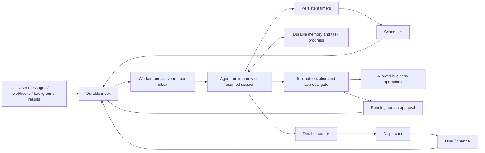

# Always-On Agents on the Microsoft Stack

Anthropic's excellent article, [Building always-on agents][anthropic] by William Hu, inspired this repository. Published on November 13, 2026, it explains how agents can respond to events, follow up on tasks, and maintain context across sessions.

**This repository helps AI engineers build always-on agents with Microsoft AI solutions.** It maps the pattern to [Microsoft Agent Framework](https://learn.microsoft.com/agent-framework/), [Microsoft Foundry](https://learn.microsoft.com/azure/foundry/), and [Azure](https://azure.microsoft.com/), compares implementation options, and highlights GA versus preview features and UAE North availability.

## What is an always-on agent?

An always-on agent can act when something happens, not only when a user sends a prompt. A webhook, scheduled follow-up, background result, or user message can start its next run.

**Always-on does not mean continuously running inference.** The agent wakes, loads context, reasons and uses tools, saves progress, then sleeps. A *run* is one stretch of work. A *session* holds messages and tool calls and can span several runs.

Anthropic describes five building blocks:

| Primitive | Responsibility |
| --- | --- |
| Event inbox | Store incoming events reliably, deduplicate them, and batch related messages. |
| Timers | Schedule follow-ups and recurring work. Due timers create inbox events. |
| Memory | Retain useful context and task progress across runs. Link to existing records instead of copying them. |
| Permissions | Control tool access and wait for approval before sensitive actions. |
| Outbox | Queue outgoing messages for delivery, retries, and pacing. Not every run needs to send a message. |

For example, a support agent can receive a case update, investigate it, request approval for a response, and follow up the next day. It does not need to keep a worker or model running while it waits.

The article also describes optional memory curation, called *dreaming*: reviewing past sessions to improve stored memories.

## How the cycle fits together

Start with one inbox per user and one active worker per inbox. Deliver approval requests through the user interface or outbox; the user's decision returns as an event. Waiting for approval should release the worker.

## Choose an implementation approach

### A. Code-first: Agent Framework + Durable Functions

**Best for custom agent logic and control over durable execution.**

Use **Microsoft Agent Framework** for the agent loop, tools, sessions, and approval requests. Use **Durable Functions** for recoverable orchestration, timers, and external-event waits, and **Azure OpenAI** for model inference. The Durable Task extension adds persistent agent sessions.

You implement inbox deduplication and batching, memory policies, tool authorization, the approval interface, and reliable delivery.

For other hosting requirements, Agent Framework and the Durable Task SDKs can run on **Container Apps, App Service, or AKS**.

### B. Foundry-native: prompt or hosted agents + routines

**Best for managed agent hosting and operations.**

Choose **prompt agents** to configure instructions, models, and tools without managing agent hosting code. Choose **hosted agents** to run your own code in a managed runtime with persistent session files.

**Routines** invoke agents on schedules or supported external events. You still design business-level deduplication, approvals, memory, and outbound delivery. The built-in self-reminder tool and managed long-term memory are **preview**.

### C. Hybrid: Azure durability + a Foundry agent

**Best for managed agents with explicit business-process control.**

Use Azure services for the inbox, timers, approvals, and delivery. Invoke a Foundry agent for reasoning and tool use.

This also works around regional gaps in Foundry routines, including UAE North. You need to coordinate session IDs, retries, task state, and completion across both runtimes.

### D. Integration and low-code: Logic Apps or Copilot Studio

**Best for connector-heavy business automation.**

**Logic Apps Standard Agent Loop** combines agent reasoning with integration workflows and enterprise connectors. **Copilot Studio autonomous agents** provide low-code, event-driven business agents.

Check connector limits, authentication, memory, approvals, and delivery behavior. Copilot Studio's documented event-trigger path uses maker credentials.

## What is GA, and what is preview?

**As of November 16, 2026**, based on the linked Microsoft documentation and announcements. A GA service can still include preview features or SDK integrations.

| Capability | Documented status | Implication |
| --- | --- | --- |
| Microsoft Agent Framework core | **1.0 GA**, April 2, 2026 ([announcement][maf-ga]). | Suitable foundation for a code-first agent. Check extensions independently. |
| Durable Task extension for Agent Framework | **GA**, November 9, 2026 ([announcement][durable-agent-ga]). | Durable agents/workflows support .NET and Python, with Functions or self-hosted workers. |
| Python Functions agent bindings | **Preview** ([quickstart][python-bindings]). | These are a separate integration from the GA Durable Task extension. Exclude them from a GA-only implementation. |
| Durable Task Scheduler: Dedicated | **GA**, November 18, 2025 ([release][dts-dedicated-ga]). | Fixed-capacity backend; compute hosting is billed separately. |
| Durable Task Scheduler: Consumption | **GA**, May 4, 2026 ([release][dts-consumption-ga]). | Pay-per-action alternative; Dedicated is not required merely to avoid preview. |
| Foundry Agent Service | **GA service** ([announcement][agent-service-ga], [current overview][foundry-overview]). | Does not imply that every agent type, tool, or SDK feature is GA. |
| Foundry hosted agents | **GA** ([Microsoft article][hosted-ga], [current documentation][hosted]). | Custom agent code in managed, per-session sandboxes with stateful resume. |
| Foundry routines | **GA**, September 24, 2026 ([announcement][routines-ga]). | One-shot timers, recurring schedules, and supported external events. Regional and SDK constraints still apply. |
| Foundry reminder tool | **Preview** ([documentation][reminders]). | Hosted-agent self-scheduling on the same conversation; not a GA substitute for application-owned timers. |
| Foundry managed memory / Memory Store API | **Public preview** ([documentation][memory]). | Optional managed long-term memory; not required to implement the pattern. |
| Foundry workflow agents | **Preview** ([documentation][foundry-workflows]). | Distinct from Agent Framework workflows and Durable Functions orchestrations. |
| Azure OpenAI v1 API | **GA API**, including the documented Responses API path ([API lifecycle][openai-v1]). | Select a supported GA model and features; not all capabilities exposed through v1 are GA. |
| Logic Apps Standard Agent Loop | **GA**, November 18, 2025 ([announcement][logic-ga]). | A credible integration-first option. Consumption agentic workflows and some advanced integrations remain preview ([documentation][logic-agents]). |
| Copilot Studio autonomous agents | **GA**, March 2025 ([announcement][studio-ga]). | Event-driven low-code option; validate the specific harness, connectors, authentication, and environment policies ([limitations][studio-triggers]). |

The Python packages [`agent-framework-durabletask`][pypi-durable] and [`agent-framework-azurefunctions`][pypi-functions] have stable `1.0.0` releases. They are separate from the preview Python agent bindings. Pin compatible stable versions when building a GA-only solution.

## Map the building blocks to Microsoft services

Choose the services your application needs; you do not need every option below.

| Building block | Microsoft options | Design consideration |
| --- | --- | --- |
| Inbox | Azure SQL or another durable database; Service Bus queues/sessions; Foundry routines for supported triggers. | Track event IDs and processing status. Broker deduplication does not prevent redelivery. |
| Timers | Durable Functions timers, Durable Task SDKs, Foundry routines, or Logic Apps recurrence. | Associate each timer with its task/session. The Foundry self-reminder tool is preview. |
| Memory | Azure SQL, Cosmos DB, Blob Storage, or hosted-agent persistent files. | Separate task state from long-term memory. Define scope, retention, and deletion. |
| Permissions | Managed identity, Entra RBAC, Key Vault, controlled tool backends, and Agent Framework [tool approvals][approvals]. | Enforce authorization in code. Bind approval to the exact action and arguments. |
| Outbox | A durable database outbox with a Functions or worker dispatcher; Service Bus or Logic Apps for delivery integrations. | Record outgoing work with the related state change. Make retries safe at the destination. |

An outbox alone does not guarantee exactly-once delivery to an external system. See Microsoft's [Idempotent Consumer pattern][idempotency] and [Service Bus reliability guidance][servicebus].

## UAE North availability

**Snapshot: November 16, 2026.** Regional support does not establish subscription access, quota, or capacity.

| Service or feature | UAE North status | Important constraint |
| --- | --- | --- |
| Foundry hosted agents | Listed as supported ([regions][hosted]). | Check the selected model, tools, and runtime features separately. |
| Azure OpenAI Responses API | Listed as supported ([regions][responses]). | Check the model, version, deployment type, and quota separately. |
| Foundry routines | **Not available** ([limitations][routines]). | Use Azure-managed scheduling and invocation instead. |
| Foundry managed memory | Listed as supported, but **preview** ([limitations][memory]). | Memory stores do not support VNet integration. |
| Durable Task Scheduler | Confirm through the resource provider ([documentation][dts]). | The documentation directs readers to query current regional availability before selecting the backend. |

**Data residency:** a resource in UAE North does not guarantee UAE-only model processing. Global deployments may process elsewhere; select the deployment type against the required processing boundary ([deployment types][deployment-types]).

## Foundry routine constraints

| Constraint | What it means |
| --- | --- |
| One trigger and one action | Each routine invokes one prompt or hosted agent, not a workflow agent. |
| Supported event sources | GitHub issues and Teams messages; other sources need a separate integration. |
| Recurring schedule interval | At least five minutes. |
| Conversation continuity | Ordinary routines start new conversations. The preview reminder tool resumes the same conversation. |
| Network and encryption | VNet-secured projects are supported; customer-managed key encryption is not. |
| Dispatch versus completion | A successful dispatch does not prove that asynchronous agent work finished. The 30-second Responses dispatch timeout covers background-request acceptance, not the entire run. |

Sources: [routines][routines] and [reminder tool][reminders].

## Build with GA components

For a code-first solution, **Microsoft Agent Framework + Durable Functions + Azure OpenAI** is a practical starting point. Use the GA Durable Task extension for session durability, or invoke the agent from durable activities and manage session persistence explicitly.

- Keep model and network calls outside deterministic orchestration code.
- Make external actions safe to retry, including failures between execution and checkpointing.
- Persist approvals and release workers while waiting.
- Use application-managed memory and durable timers instead of preview memory and reminder features.
- Choose a supported GA model with the required quota and data-processing boundary.
- Compare Scheduler Consumption and Dedicated costs. Sleeping agents can still incur storage and provisioned-capacity charges.

Recheck feature availability, support requirements, and regional constraints before deployment.

[anthropic]: https://claude.com/resources/articles/building-always-on-agents
[maf-ga]: https://devblogs.microsoft.com/agent-framework/microsoft-agent-framework-at-build-2026-announce/
[durable-agent-ga]: https://techcommunity.microsoft.com/blog/appsonazureblog/durable-task-extension-for-microsoft-agent-framework-is-now-generally-available/4571100
[python-bindings]: https://learn.microsoft.com/azure/azure-functions/functions-agent-bindings-agent-framework-durable
[dts-dedicated-ga]: https://azure.microsoft.com/updates?id=525518
[dts-consumption-ga]: https://azure.microsoft.com/updates?id=560957
[dts]: https://learn.microsoft.com/azure/durable-task/scheduler/durable-task-scheduler
[agent-service-ga]: https://techcommunity.microsoft.com/blog/azure-ai-foundry-blog/announcing-general-availability-of-azure-ai-foundry-agent-service/4414352
[foundry-overview]: https://learn.microsoft.com/azure/foundry/agents/overview
[hosted-ga]: https://techcommunity.microsoft.com/blog/azuredevcommunityblog/running-hosted-agents-in-microsoft-foundry-agent-service-part-35/4541933
[hosted]: https://learn.microsoft.com/azure/foundry/agents/concepts/hosted-agents
[routines-ga]: https://devblogs.microsoft.com/foundry/from-chatbots-to-automated-assistants-routines-in-microsoft-foundry-are-now-generally-available/
[routines]: https://learn.microsoft.com/azure/foundry/agents/how-to/use-routines
[reminders]: https://learn.microsoft.com/azure/foundry/agents/how-to/tools/reminder-tool
[memory]: https://learn.microsoft.com/azure/foundry/agents/concepts/what-is-memory
[foundry-workflows]: https://learn.microsoft.com/azure/foundry/agents/concepts/workflow
[openai-v1]: https://learn.microsoft.com/azure/foundry/openai/api-version-lifecycle
[responses]: https://learn.microsoft.com/azure/foundry/openai/how-to/responses
[deployment-types]: https://learn.microsoft.com/azure/ai-foundry/openai/how-to/deployment-types
[logic-ga]: https://techcommunity.microsoft.com/blog/integrationsonazureblog/%F0%9F%8E%89announcing-general-availability-of-agent-loop-in-azure-logic-apps/4470739
[logic-agents]: https://learn.microsoft.com/azure/logic-apps/agent-workflows-concepts
[studio-ga]: https://www.microsoft.com/en-us/copilot/blog/copilot-studio/whats-new-in-copilot-studio-march-2025/
[studio-triggers]: https://learn.microsoft.com/microsoft-copilot-studio/authoring-triggers-about
[approvals]: https://learn.microsoft.com/agent-framework/agents/tools/tool-approval
[idempotency]: https://learn.microsoft.com/azure/architecture/patterns/idempotent-consumer
[servicebus]: https://learn.microsoft.com/azure/well-architected/service-guides/azure-service-bus
[pypi-durable]: https://pypi.org/project/agent-framework-durabletask/1.0.0/
[pypi-functions]: https://pypi.org/project/agent-framework-azurefunctions/1.0.0/
