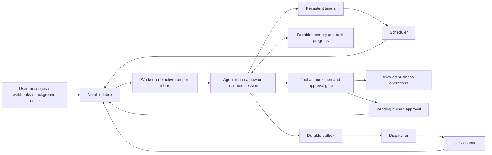

# Always-On Agents on the Microsoft Stack

Understanding Anthropic's always-on agent pattern and exploring how to implement it with Microsoft Agent Framework, Microsoft Foundry, and Azure.

**Status: research and design only.** No runnable agent, tests, or deployment exist yet. The example scenario and final stack are still to be agreed.

**Availability checked: November 16, 2026.** The status below is based on linked Microsoft documentation and announcements, not deployment testing. GA status, SDK maturity, regional availability, and model capacity are separate checks.

## Start with the article

William Hu's [Building always-on agents][anthropic], published by Anthropic on November 13, 2026, describes agents that maintain continuity across sessions and act on events without waiting for a new user prompt.

**Always-on does not mean continuously running inference.** The agent usually sleeps. An event wakes it for a bounded run: restore the relevant context, reason and use tools, save progress, then sleep again. A session is the transcript of messages and tool calls; it can span multiple runs.

The architecture around the agent has five primitives:

| Primitive | Responsibility |
| --- | --- |
| Event inbox | Durably accept events, deduplicate source IDs, track status, and batch related messages before processing. Start with one inbox per user and one active worker per inbox. |
| Timers | Persist agent-requested follow-ups and recurring schedules. Due timers create inbox events rather than bypassing the inbox. |
| Memory | Retain instructions, useful learned context, communication history, and task progress across runs. Prefer pointers to authoritative systems over copied records. |
| Permissions | Enforce allowed actions, keep credentials outside the model's reach, and defer sensitive tool calls until an authorized person approves. |
| Outbox | Separate deciding what to communicate from delivering it, with pacing and retry handling when needed. A run can also finish silently. |

Memory curation from past sessions, called *dreaming* in the article, is optional. It is not a sixth required primitive.

This repository offers an independent Microsoft-stack interpretation of the pattern, not a port of an Anthropic product or a claim that the pattern requires a particular model vendor.

## How the cycle fits together

The diagram is conceptual, not a deployed architecture. Approval requests also need a user-facing delivery path. While a task waits for approval, its worker should be free to process other work.

## Microsoft options

Foundry and Azure are not competing choices. Foundry provides models and managed agent capabilities on Azure; Azure services can supply the durable application infrastructure around them.

### A. Code-first: Agent Framework + Durable Functions

**Best for teaching the architecture through a small code example.**

Microsoft Agent Framework supplies reasoning, tools, sessions, and tool-approval requests. Durable Functions supplies recoverable orchestration, timers, and waits for external events. The Durable Task extension can persist agent sessions, while Azure OpenAI supplies model inference.

The application still owns inbox deduplication and batching, long-term memory policy, tool authorization, approval UX, and reliable outbound effects. This approach makes all five primitives visible instead of hiding them behind a managed service.

Agent Framework can also run on Container Apps, App Service, or AKS. The Durable Task SDKs support bringing your own compute; adopting durable execution does not force Azure Functions hosting. This flexibility adds deployment choices, not a reason to provision more services for a small example.

### B. Foundry-native: prompt or hosted agents + routines

**Best for managed agent hosting and operations.**

With **prompt agents**, configure instructions, models, and tools, and let Foundry run the agent. With **hosted agents**, deploy your own agent code into a managed runtime with persistent session files.

**Routines** invoke agents on schedules, at a future time, or for supported external events, and record dispatch results. Business deduplication, approvals, notification policy, and reliable external effects still need deliberate design. The built-in self-reminder tool and managed long-term memory remain preview.

### C. Hybrid: Azure durability + a Foundry agent

**Best for managed agents with explicit business-process control.**

Azure owns the durable inbox, timer, approval, and delivery lifecycle. It invokes a Foundry agent for reasoning and tool use.

This is useful when Foundry routines are unavailable in the required region, including UAE North. The trade-off is coordinating session IDs, retries, task state, and asynchronous completion across two runtimes.

### D. Integration and low-code: Logic Apps or Copilot Studio

**Best for connector-heavy business automation.**

**Logic Apps Standard Agent Loop** combines agent reasoning with integration workflows and enterprise connectors. **Copilot Studio autonomous agents** provide low-code, event-driven business agents.

These are credible alternatives, but their feature-specific limits, identity, durable memory, approval behavior, and delivery guarantees still need review. In particular, Copilot Studio's documented event-trigger path uses maker credentials. A code-first reference is better suited to exposing the mechanics of all five primitives.

## What is GA, and what is preview?

GA applies to a specific capability, not everything under a product brand. A GA service can have preview tools or language integrations.

| Capability | Verified status | Implication |
| --- | --- | --- |
| Microsoft Agent Framework core | **1.0 GA**, April 2, 2026 ([announcement][maf-ga]). | Suitable foundation for a code-first agent. Check extensions independently. |
| Durable Task extension for Agent Framework | **GA**, November 9, 2026 ([announcement][durable-agent-ga]). | Durable agents/workflows support .NET and Python, with Functions or self-hosted workers. |
| Python Functions agent bindings | **Preview** ([quickstart][python-bindings]). | These are a separate integration from the GA Durable Task extension. Do not select them for a strict GA-only example. |
| Durable Task Scheduler: Dedicated | **GA**, November 18, 2025 ([release][dts-dedicated-ga]). | Fixed-capacity backend; compute hosting is billed separately. |
| Durable Task Scheduler: Consumption | **GA**, May 4, 2026 ([release][dts-consumption-ga]). | Pay-per-action alternative; Dedicated is not required merely to avoid preview. |
| Foundry Agent Service | **GA service** ([announcement][agent-service-ga], [current overview][foundry-overview]). | Does not imply that every agent type, tool, or SDK feature is GA. |
| Foundry hosted agents | **GA** ([Microsoft article][hosted-ga], [current documentation][hosted]). | Custom agent code in managed, per-session sandboxes with stateful resume. |
| Foundry routines | **GA**, September 24, 2026 ([announcement][routines-ga]). | One-shot timers, recurring schedules, and supported external events. Regional and SDK constraints still apply. |
| Foundry reminder tool | **Preview** ([documentation][reminders]). | Hosted-agent self-scheduling on the same conversation; not a GA substitute for application-owned timers. |
| Foundry managed memory / Memory Store API | **Public preview** ([documentation][memory]). | Optional managed long-term memory; not required to implement the pattern. |
| Foundry workflow agents | **Preview** ([documentation][foundry-workflows]). | Distinct from Agent Framework workflows and Durable Functions orchestrations. |
| Azure OpenAI v1 API | **GA API**, including the documented Responses API path ([API lifecycle][openai-v1]). | Select a supported GA model and features; not all capabilities exposed through v1 are GA. |
| Logic Apps Standard Agent Loop | **GA**, November 18, 2025 ([announcement][logic-ga]). | A credible integration-first option. Consumption agentic workflows and some advanced integrations remain preview ([documentation][logic-agents]). |
| Copilot Studio autonomous agents | **GA**, March 2025 ([announcement][studio-ga]). | Event-driven low-code option; validate the specific harness, connectors, authentication, and environment policies ([limitations][studio-triggers]). |

Package evidence: PyPI lists stable `1.0.0` releases of both [`agent-framework-durabletask`][pypi-durable] and [`agent-framework-azurefunctions`][pypi-functions], published November 9, 2026. They were inspected, **not installed or tested**. Some Learn installation examples still include prerelease flags; implementation must pin and validate a coherent stable dependency set rather than copy a preview example blindly.

## Mapping the five primitives

These are options, not a requirement to deploy every listed service.

| Primitive | Microsoft implementation options | Important boundary |
| --- | --- | --- |
| Inbox | An application event ledger in Azure SQL or another durable database; optionally Service Bus queues/sessions for transport and serialized processing. Foundry routines manage dispatch for supported triggers. | Broker deduplication is bounded and does not prevent consumer redelivery. A session lock does not by itself serialize an asynchronous agent task after the receiver releases it. |
| Timers | Durable Functions timers and external events; Durable Task SDKs on other compute; supported Foundry routines; Logic Apps recurrence. | Persist a correlation to the task/session. Foundry's built-in agent-directed reminder tool is preview. |
| Memory | Application-managed records or documents in Azure SQL, Cosmos DB, or Blob Storage; hosted-agent persistent files where appropriate. | Conversation history and orchestration checkpoints are not a complete cross-session memory policy. Define scope, retention, provenance, deletion, and concurrency. |
| Permissions | Managed identity and Entra RBAC for service access; Key Vault for necessary secrets; controlled tool backends/proxies; Agent Framework [tool approvals][approvals] plus a durable approval workflow. | Model instructions and approval flags are not authorization boundaries. Authenticate the approver and bind the decision to the exact pending action and arguments. |
| Outbox | An application outbox recorded with the related state change, dispatched by Functions or a worker; optional Service Bus/Logic Apps delivery integrations. | Delivery retries need idempotency or reconciliation at the destination. An outbox alone cannot guarantee exactly-once effects in an arbitrary external system. |

See Microsoft's [Idempotent Consumer pattern][idempotency] and [Service Bus reliability guidance][servicebus] for the distinction between duplicate-send filtering and idempotent business processing.

## UAE North and enterprise constraints

**Snapshot: November 16, 2026.** Regional support does not establish subscription access, quota, or capacity.

| Service or feature | UAE North status | Important constraint |
| --- | --- | --- |
| Foundry hosted agents | Listed as supported ([regions][hosted]). | Check the selected model, tools, and runtime features separately. |
| Azure OpenAI Responses API | Listed as supported ([regions][responses]). | A particular model/version/deployment type and quota are not established by API availability. |
| Foundry routines | **Not available** ([limitations][routines]). | Also excluded in UK West, Switzerland West, Japan West, and Norway East. Routines support VNet-secured projects but not customer-managed key encryption. |
| Foundry managed memory | Listed as supported, but **preview** ([limitations][memory]). | Memory stores do not support VNet integration. |
| Durable Task Scheduler | **Not verified against a target subscription** ([documentation][dts]). | Query the resource provider for current regional availability before selecting the backend. |

**Data residency:** a resource in UAE North does not guarantee UAE-only model processing. Global deployments may process elsewhere; select the deployment type against the required processing boundary ([deployment types][deployment-types]).

Additional Foundry routine constraints matter for a faithful implementation:

- Each routine has one trigger and one action; it invokes a prompt or hosted agent, not a workflow agent.
- Documented external event sources are GitHub issues and Teams messages, not an arbitrary universal event bus.
- Recurring schedules have a minimum five-minute interval.
- Ordinary routines start new conversations; the preview reminder tool resumes the same conversation.
- Successful dispatch is not proof that asynchronous agent work completed. The documented 30-second downstream timeout for Responses actions concerns background-request acceptance, not the agent's total execution time.

Sources: [routines][routines] and [reminder tool][reminders].

## Proposed direction, not a final decision

For an educational code sample, the leading option is **Microsoft Agent Framework + Durable Functions + Azure OpenAI**, with explicit inbox, memory, approval, and outbox behavior. The GA Durable Task extension is a candidate for session durability. Conventional agent calls inside durable activities are another option if the sample needs a more explicit implementation.

Keep model/network calls out of deterministic orchestration code. Recovery can reuse recorded results, but a crash between an external side effect and its checkpoint still requires idempotency. Configure waits so they release workers; that does not make storage, provisioned capacity, or every hosting plan free while idle.

Do not require Foundry managed memory, the preview reminder tool, or preview Python agent bindings. Keep the model selectable rather than assume a specific model or provisioned capacity is available. Evaluate Scheduler Consumption versus Dedicated against cost and operational requirements, not only GA status.

Next, agree one small scenario that demonstrates receiving an event, batching messages, scheduling a follow-up, waiting for approval, and reliably delivering an outcome. Then implement an offline mock-backed path before attempting live Azure integration.

## What has actually been verified?

| Check | Result |
| --- | --- |
| Anthropic pattern and Microsoft capability/status research | Reviewed the linked article, Microsoft documentation, and dated announcements. |
| Durable extension Python release metadata | Stable package releases inspected on PyPI; no dependency installation or compatibility test. |
| Example scenario and architecture selection | Pending discussion. |
| Offline demo, unit tests, Functions host, and emulator | Not implemented or run. |
| Azure resource availability, subscription quota, and cost | Not checked against a subscription. |
| Live model call or Azure deployment | Not performed. |

This is an independent educational reference, not production certification or an official support commitment. Recheck the linked sources before implementation or customer deployment.

[anthropic]: https://claude.com/resources/articles/building-always-on-agents
[maf-ga]: https://devblogs.microsoft.com/agent-framework/microsoft-agent-framework-at-build-2026-announce/
[durable-agent-ga]: https://techcommunity.microsoft.com/blog/appsonazureblog/durable-task-extension-for-microsoft-agent-framework-is-now-generally-available/4571100
[python-bindings]: https://learn.microsoft.com/azure/azure-functions/functions-agent-bindings-agent-framework-durable
[dts-dedicated-ga]: https://azure.microsoft.com/updates?id=525518
[dts-consumption-ga]: https://azure.microsoft.com/updates?id=560957
[dts]: https://learn.microsoft.com/azure/durable-task/scheduler/durable-task-scheduler
[agent-service-ga]: https://techcommunity.microsoft.com/blog/azure-ai-foundry-blog/announcing-general-availability-of-azure-ai-foundry-agent-service/4414352
[foundry-overview]: https://learn.microsoft.com/azure/foundry/agents/overview
[hosted-ga]: https://techcommunity.microsoft.com/blog/azuredevcommunityblog/running-hosted-agents-in-microsoft-foundry-agent-service-part-35/4541933
[hosted]: https://learn.microsoft.com/azure/foundry/agents/concepts/hosted-agents
[routines-ga]: https://devblogs.microsoft.com/foundry/from-chatbots-to-automated-assistants-routines-in-microsoft-foundry-are-now-generally-available/
[routines]: https://learn.microsoft.com/azure/foundry/agents/how-to/use-routines
[reminders]: https://learn.microsoft.com/azure/foundry/agents/how-to/tools/reminder-tool
[memory]: https://learn.microsoft.com/azure/foundry/agents/concepts/what-is-memory
[foundry-workflows]: https://learn.microsoft.com/azure/foundry/agents/concepts/workflow
[openai-v1]: https://learn.microsoft.com/azure/foundry/openai/api-version-lifecycle
[responses]: https://learn.microsoft.com/azure/foundry/openai/how-to/responses
[deployment-types]: https://learn.microsoft.com/azure/ai-foundry/openai/how-to/deployment-types
[logic-ga]: https://techcommunity.microsoft.com/blog/integrationsonazureblog/%F0%9F%8E%89announcing-general-availability-of-agent-loop-in-azure-logic-apps/4470739
[logic-agents]: https://learn.microsoft.com/azure/logic-apps/agent-workflows-concepts
[studio-ga]: https://www.microsoft.com/en-us/copilot/blog/copilot-studio/whats-new-in-copilot-studio-march-2025/
[studio-triggers]: https://learn.microsoft.com/microsoft-copilot-studio/authoring-triggers-about
[approvals]: https://learn.microsoft.com/agent-framework/agents/tools/tool-approval
[idempotency]: https://learn.microsoft.com/azure/architecture/patterns/idempotent-consumer
[servicebus]: https://learn.microsoft.com/azure/well-architected/service-guides/azure-service-bus
[pypi-durable]: https://pypi.org/project/agent-framework-durabletask/1.0.0/
[pypi-functions]: https://pypi.org/project/agent-framework-azurefunctions/1.0.0/
